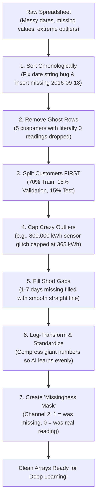
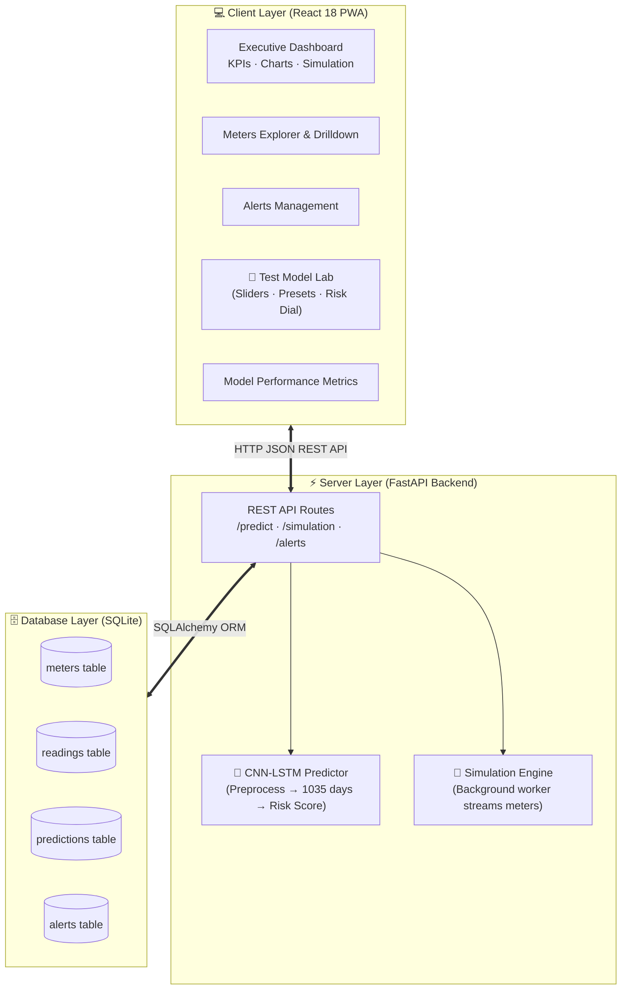
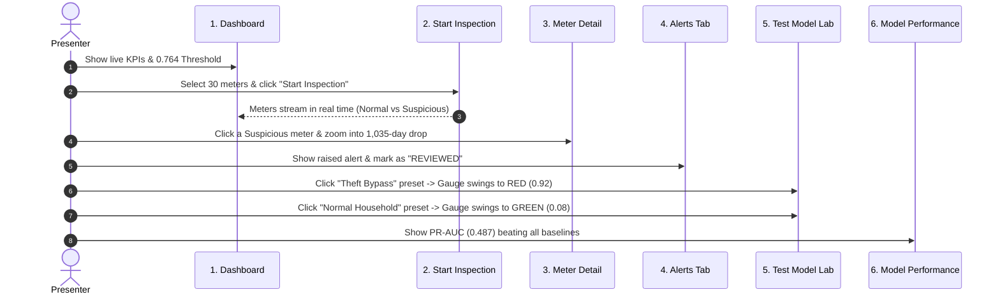

# ⚡ Electricity Theft Detection System — Complete "Zero Knowledge" Guide

> **Who is this guide for?**  
> Absolutely **anyone**. Even if you have **never** written a line of code, don't know what a neural network is, or have never taken an AI class in your life — by the time you finish reading this, you will understand **100% of this project** and be able to explain it to anyone (including a viva examiner!).

---

## 📑 Table of Contents

1. [The Real-World Story: Why Does This Project Exist?](#1-the-real-world-story-why-does-this-project-exist)
2. [How Do People Steal Electricity? (And Why Simple Rules Fail)](#2-how-do-people-steal-electricity-and-why-simple-rules-fail)
3. [The Core Idea: What Does Our AI Actually Do?](#3-the-core-idea-what-does-our-ai-actually-do)
4. [The Dataset: What Raw Data Do We Have?](#4-the-dataset-what-raw-data-do-we-have)
5. [Data Cleaning: Why Raw Data is a Mess (And How We Fix It)](#5-data-cleaning-why-raw-data-is-a-mess-and-how-we-fix-it)
6. [The "Needle in a Haystack" Problem: Why 90% Accuracy is Useless](#6-the-needle-in-a-haystack-problem-why-90-accuracy-is-useless)
7. [The 5 AI Models Detailed & Compared with Real-World Analogies](#7-the-5-ai-models-detailed--compared-with-real-world-analogies)
8. [The Confusion Matrix Explained in Everyday Human Terms](#8-the-confusion-matrix-explained-in-everyday-human-terms)
9. [The Decision Threshold (0.764): The Alarm Sensitivity Dial](#9-the-decision-threshold-0764-the-alarm-sensitivity-dial)
10. [The Scoreboard: Final Results & Comparison](#10-the-scoreboard-final-results--comparison)
11. [System Architecture: How Backend, Database & Frontend Connect](#11-system-architecture-how-backend-database--frontend-connect)
12. [Tour of Every Tab & Feature in the App (What Does Each Screen Do?)](#12-tour-of-every-tab--feature-in-the-app-what-does-each-screen-do)
13. [Step-by-Step Project Demo Flow (How to Present in Viva)](#13-step-by-step-project-demo-flow-how-to-present-in-viva)
14. [Cloud Deployment (Render + Vercel)](#14-cloud-deployment-render--vercel)
15. [Limitations & Ethical Boundaries (What the System CANNOT Do)](#15-limitations--ethical-boundaries-what-the-system-cannot-do)
16. [Top Viva / Interview Questions & Crystal-Clear Answers](#16-top-viva--interview-questions--crystal-clear-answers)

---

## 1. The Real-World Story: Why Does This Project Exist?

Imagine you run an electric utility company (like K-Electric, WAPDA, or State Grid). You generate electricity, send it through power cables, and install a **digital smart meter** outside every home and factory.

At the end of the month:
- Your power plant generated **1,000,000 units** of electricity.
- But when you add up all the customer meter bills, they only paid for **750,000 units**.

**Where did 250,000 units go?**  
Part of it is lost naturally as heat in the wires (technical loss). But a huge chunk is stolen — people bypassing meters or tampering with them. This is called **Non-Technical Loss (NTL)**, and it costs utility companies **billions of dollars** every single year.

### The Old Way of Finding Thieves:
You hire inspectors and tell them: *"Go knock on doors and inspect meters."*
- There are **millions** of meters.
- Inspectors only have time to check maybe 50 a day.
- Inspecting an innocent grandmother's meter wastes money, time, and annoys the customer.
- Inspectors have no idea which houses are suspicious, so they are basically guessing blindly.

### Our Solution:
Instead of guessing, our **AI system looks at daily meter readings** and gives every meter a **Risk Score between 0% and 100%**.  
- Normal meters get scores like `5%` or `12%`.
- Suspicious meters get scores like `85%` or `94%`.

Now, the utility company gives inspectors a **prioritized list**:  
*"Don't guess blindly. Go inspect these 20 meters with a 90%+ risk score today."*

---

## 2. How Do People Steal Electricity? (And Why Simple Rules Fail)

You might think: *"Can't we just write a simple `if` statement to look for meters showing 0 electricity?"*

**No! Real-world electricity theft is much smarter and trickier than that:**

1. **The Partial Bypass (Kunda / Shunt Wire):**  
   The thief runs heavy appliances (air conditioners, heavy machinery) directly off the main electrical wire outside the meter, while running low-power lights through the meter. The meter still ticks 5 to 10 units a day — so simple "zero-check" rules never catch them!
2. **The Sudden Drop:**  
   A business was legitimately consuming 100 units a day for 2 years. Suddenly in year 3, consumption drops to 20 units a day without explanation (they installed a bypass).
3. **The Tampering Glitch (Missing Readings):**  
   Someone physically tampers with the digital meter using magnets or frequency jammers. As a result, the meter stops recording or fails to transmit readings for several days or weeks at a time.
4. **Reverse / Slowed Metering:**  
   The meter hardware is modified so it ticks 50% slower than it should.

A human looking at a spreadsheet of 1,000 numbers cannot spot these subtle patterns across 40,000 customers. But **deep learning algorithms excel at spotting patterns over time**.

---

## 3. The Core Idea: What Does Our AI Actually Do?

Think of our AI as a **specialized medical doctor**, but for electricity meters instead of human heartbeats:

```
[ 1,035 Days of Daily Electricity Readings ]
                 │
                 ▼
       ┌──────────────────┐
       │   AI Predictor   │  (Trained on historical data)
       └──────────────────┘
                 │
                 ▼
      Risk Score: 0.892 (89.2%)
                 │
                 ▼
       🚨 SUSPICIOUS PATTERN DETECTED
       "Recommendation: Prioritize for field inspection"
```

1. It takes the customer's daily electricity history (1,035 consecutive days).
2. It looks at the **shape of the curve**, the **weekly rhythm** (weekday vs weekend), seasonal changes (summer vs winter), and missing data gaps.
3. It outputs a **Risk Score from 0.0 to 1.0**.
4. If the risk score is higher than our tested safety threshold (**0.764**), it marks the meter **SUSPICIOUS** and automatically creates an **Alert**.

---

## 4. The Dataset: What Raw Data Do We Have?

We use the real-world **SGCC (State Grid Corporation of China)** dataset — one of the largest public smart-meter datasets in the world.

| Fact | Number | What it means |
|---|---|---|
| **Total Customers** | **42,372** | Over forty-two thousand real homes and businesses |
| **Duration** | **1,035 days** | Nearly 3 full years of daily readings (2014 to 2016) |
| **Normal Customers** | **38,757 (91.5%)** | Honest customers who paid their bills |
| **Theft Customers** | **3,615 (8.5%)** | Confirmed theft cases caught by real utility inspectors |

### What the spreadsheet looks like:
Imagine a massive Excel table with 42,372 rows and 1,036 columns:

| Customer ID | Label | Day 1 (Jan 1) | Day 2 (Jan 2) | ... | Day 1,035 (Oct 31) |
|:---:|:---:|:---:|:---:|:---:|:---:|
| `C1001` | `0` (Normal) | 5.2 kWh | 5.8 kWh | ... | 6.1 kWh |
| `C1002` | `1` (Theft) | 18.4 kWh | 2.1 kWh | ... | 0.0 kWh *(Sudden drop)* |
| `C1003` | `0` (Normal) | 3.5 kWh | *NaN* | ... | 4.0 kWh *(Missing day)* |

### Surprising Things We Discovered in the Data (EDA):
- 💡 **Theft customers actually consume MORE on average than normal customers!** (8.8 kWh/day vs 5.5 kWh/day). Why? Commercial shops, factories, and heavy AC users are the ones most tempted to steal large amounts.
- 💡 **Theft is not just "zero usage":** It shows up as sudden, permanent drops or wild fluctuations.
- 💡 **Missing readings are a huge clue:** Meters with theft labels had more than **twice as many missing days** (21% missing vs 10% missing). Tampering damages digital communication!

---

## 5. Data Cleaning: Why Raw Data is a Mess (And How We Fix It)

Raw data straight from the field is full of errors, missing values, and corrupted files. If you feed garbage into an AI, you get garbage out (*"Garbage In, Garbage Out"*).

Here is how our pipeline cleans it step-by-step:



### 🚨 Golden Rule: No Data Leakage!
Notice Step 3: **We split the data into Train (70%), Validation (15%), and Test (15%) BEFORE computing any averages or statistics.**  
*Why?*  
If you calculate the average or maximum using the whole dataset, your AI gets an "unfair sneak peek" at the test exam before taking it. That is called **data leakage** and produces fake, dishonest results. Our pipeline ensures strict honesty.

---

## 6. The "Needle in a Haystack" Problem: Why 90% Accuracy is Useless

This is the **most important concept** to understand for any viva or technical discussion!

In our dataset:
- **91.5%** of customers are Normal.
- **8.5%** of customers are Theft.

Imagine a really lazy, dumb model that doesn't look at any readings at all and simply shouts:  
> *"EVERYONE IS NORMAL! NOBODY IS STEALING!"*

Guess what? That dumb model will be **91.5% ACCURATE**!  
It gets an A+ grade in basic accuracy, but in the real world it is **100% useless** because it caught **zero thieves**!

### What Metrics Do We Actually Care About?

| Metric | What It Asks | Why It Matters |
|---|---|---|
| **Recall** | *"Out of all 100 real thieves out there, how many did we catch?"* | If recall is 50%, we successfully caught half of all thieves in the grid. |
| **Precision** | *"When our alarm rings, how often is it a REAL thief?"* | If precision is 50%, every 2 alarms will lead inspectors to 1 actual thief (instead of 1 in 12 by random guessing). |
| **FPR (False Positive Rate)** | *"How many innocent grandmothers are we falsely accusing?"* | We want this as close to 0 as possible (ours is only 5.3%). |
| **PR-AUC (Precision-Recall Area Under Curve)** | *"Overall, how well does the model balance catching thieves without sounding false alarms?"* | **This is our primary champion metric.** A random guess gets `0.085`. Our best model gets **`0.487` (almost 6× better than random!)**. |

---

## 7. The 5 AI Models Detailed & Compared with Real-World Analogies

We implemented and rigorously benchmarked **5 distinct models** to find the absolute best approach:

```
┌────────────────────────────────────────────────────────────────────────┐
│                        MODEL LEADERBOARD                               │
├───────────────────────────────┬──────────────┬─────────────┬───────────┤
│ Model                         │ Architecture │ PR-AUC      │ Recall    │
├───────────────────────────────┼──────────────┼─────────────┼───────────┤
│ 1. Missingness-Only Baseline  │ Heuristic    │ 0.180       │ 36.5%     │
│ 2. Logistic Regression        │ Classical ML │ 0.284       │ 38.2%     │
│ 3. Random Forest              │ Classical ML │ 0.394       │ 39.1%     │
│ 4. Standalone 1D-CNN          │ Deep Learning│ 0.459       │ 48.8%     │
│ 5. Standalone LSTM            │ Deep Learning│ 0.337       │ 39.5%     │
│ ⭐ 6. CNN-LSTM (HYBRID)        │ Deep Learning│ 0.487 (WIN) │ 51.6%     │
└───────────────────────────────┴──────────────┴─────────────┴───────────┘
```

### 1. Missingness-Only Baseline (The Simple Sanity Check)
- **Concept:** It only looks at *how many readings are missing*.
- **Why we built it:** To prove that our deep learning models aren't just learning "missing data = theft". It achieved PR-AUC `0.180`. Any good model MUST beat this to prove it is learning actual electrical consumption patterns!

### 2. Logistic Regression (The Straight-Line Boundary)
- **Concept:** A classical statistical method.
- **How it works:** It takes 56 calculated numbers per customer (like overall average, variance, Monday average) and draws a straight mathematical decision line.
- **Result:** PR-AUC `0.284`. Decent baseline, but cannot capture complex, non-linear relationships.

### 3. Random Forest (The Council of 400 Trees)
- **Concept:** An ensemble of 400 decision trees.
- **How it works:** Each tree looks at different statistical features and votes "Normal" or "Theft". The majority vote wins.
- **Result:** PR-AUC `0.394`. Strongest classical baseline! Its top features were `max consumption`, `monthly variation`, and `trend slope`. But it still cannot "see" the exact day-by-day sequence.

### 4. 1D-CNN (The Magnifying Glass / Local Pattern Spotter)
- **Concept:** 1-Dimensional Convolutional Neural Network (3 Conv layers with filter kernels of size 7, 5, 3).
- **The Analogy:** Holding a magnifying glass that looks at **7 days at a time** (1 week). You slide it across the 1,035 days.
- **What it does well:** Spotting sharp weekly anomalies (e.g., normal Monday–Friday usage, but 0 usage every Saturday/Sunday).
- **The Weakness:** It pools features globally at the end, so it loses the sense of chronological order across the 3 years.
- **Result:** Very strong PR-AUC `0.459`.

### 5. Standalone LSTM (The Long-Term Diary Reader)
- **Concept:** Long Short-Term Memory (Recurrent Neural Network).
- **The Analogy:** A detective reading a meter's diary day-by-day with a memory notepad, tracking how usage shifts from 2014 to 2016.
- **The Weakness:** When fed 1,035 raw daily numbers directly, it suffers from noise and memory overload.
- **Result:** Underperformed (PR-AUC `0.337`), proving recurrent nets alone struggle without feature extraction.

### ⭐ 6. CNN-LSTM (The Hybrid Master Detective) — DEPLOYED CHAMPION
- **The Core Innovation:** Combine the magnifying glass of the CNN with the memory notepad of the LSTM!
- **How it works:**
  1. **CNN Layers (The Eyes):** 3 convolutional blocks scan the 1,035 days, filter out sensor noise, and compress the sequence **8×** (down to 129 weekly feature vectors).
  2. **LSTM Layers (The Brain):** Takes those 129 clean feature vectors and analyzes how the pattern evolved over the entire 3-year timeline.
  3. **Dense Layers (The Judge):** Outputs the final Risk Score (0.0 to 1.0).
- **Result:** **Highest PR-AUC (0.487)**, **Highest Recall (51.6%)**, and balanced FPR (5.3%).

---

## 8. The Confusion Matrix Explained in Everyday Human Terms

When our deployed CNN-LSTM model was tested on **6,355 brand new, unseen test customers**, here was the exact breakdown:

```
                              AI PREDICTION
                     ┌───────────────┬───────────────┐
                     │    NORMAL     │  SUSPICIOUS   │
       ┌─────────────┼───────────────┼───────────────┤
       │   NORMAL    │     5,506     │      307      │  Total Normal = 5,813
ACTUAL │ (Innocent)  │ (True Neg TN) │(False Pos FP) │
       ├─────────────┼───────────────┼───────────────┤
       │    THEFT    │      271      │      271      │  Total Thieves = 542
       │  (Criminal) │(False Neg FN) │ (True Pos TP) │
       └─────────────┴───────────────┴───────────────┘
```

Let's break down each box in plain human terms:

### 1. True Negatives (TN = 5,506) ✅
- **What happened:** Customer was honest, AI predicted **NORMAL**.
- **Real-world result:** 5,506 innocent families are left completely undisturbed. No unnecessary inspectors sent to their homes.

### 2. True Positives (TP = 271) 🎯
- **What happened:** Customer was stealing electricity, AI predicted **SUSPICIOUS**.
- **Real-world result:** 271 electricity thieves are successfully caught! The utility company recovers stolen revenue.

### 3. False Positives (FP = 307) ⚠️
- **What happened:** Customer was honest, but AI raised a **SUSPICIOUS** alarm.
- **Why this happened:** These customers had unusual consumption patterns (e.g., renovated their house, went on vacation for 2 months, or had a broken meter sensor).
- **Real-world result:** An inspector visits, checks the meter, finds no bypass, and marks the alert `DISMISSED` in our dashboard. Because our False Positive Rate is only **5.3%**, utility companies can easily manage this small number of false alarms.

### 4. False Negatives (FN = 271) ❌
- **What happened:** Customer was stealing, but AI marked them **NORMAL**.
- **Why this happened:** Very sneaky thieves who steal small amounts (e.g., 10% bypass), blending in with normal household variations.

### 💡 Why this is a Massive 6× Victory:
In a city of 6,355 customers, only 542 are stealing (1 out of every 12).  
If an inspector knocked on doors randomly, **only 8.5%** of inspections would find theft.  
With our CNN-LSTM system, the inspector visits **578 flagged meters** (271 + 307).  
$$\text{Hit Rate} = \frac{271}{578} = \mathbf{46.9\%}$$
**Almost 1 out of every 2 inspections is a confirmed thief!** That is a **6× improvement in inspection efficiency**!

---

## 9. The Decision Threshold (0.764): The Alarm Sensitivity Dial

The AI outputs a continuous probability between `0.000` and `1.000`.  
At what number should we ring the red siren?

- If threshold is `0.10`: Alarm rings for almost everyone. Inspectors get 3,000 false alarms.
- If threshold is `0.99`: Alarm almost never rings. We catch almost no thieves.

By plotting the Precision-Recall curve on our **validation set**, we found the optimal balance point:
$$\mathbf{\text{Threshold} = 0.764}$$

- **Score < 0.764:** Classification = `NORMAL` (Green badge, no alert).
- **Score ≥ 0.764:** Classification = `SUSPICIOUS` (Red badge, automatic alert generated).

---

## 10. The Scoreboard: Final Results & Comparison

On the held-out test set (6,355 customers):

| Model | Accuracy | Precision | Recall (Caught Thieves) | F1-Score | PR-AUC (Key Metric) | ROC-AUC | False Positive Rate |
|---|:---:|:---:|:---:|:---:|:---:|:---:|:---:|
| Missingness Baseline | 79.5% | 17.1% | 36.5% | 0.233 | 0.180 | 0.677 | 16.5% |
| Logistic Regression | 86.1% | 27.4% | 38.2% | 0.319 | 0.284 | 0.774 | 9.4% |
| Random Forest | 90.0% | 41.1% | 39.1% | 0.401 | 0.394 | 0.828 | 5.2% |
| 1D-CNN (3 seeds) | 90.1% | 43.2% | 48.8% | 0.458 | 0.459 | **0.847** | 6.0% |
| Standalone LSTM | 88.2% | 33.5% | 39.5% | 0.362 | 0.337 | 0.795 | 7.3% |
| **CNN-LSTM (Our Model)** ⭐ | **90.9%** | **46.9%** | **50.0% – 51.6%** | **0.484** | **0.487** | 0.838 | **5.3%** |

---

## 11. System Architecture: How Backend, Database & Frontend Connect



1. **Frontend (React 18 + Vite):** A responsive Progressive Web App that runs on desktop, tablet, and mobile.
2. **Backend (FastAPI):** Python web framework running asynchronous endpoints (`/predict`, `/meters`, `/alerts`, `/simulation`).
3. **Database (SQLite):** Stores meters, 1,035-day reading arrays, prediction history, and alert statuses.

---

## 12. Tour of Every Tab & Feature in the App (What Does Each Screen Do?)

Our application is divided into **6 main tabs/pages**, each built for a specific role in a utility company:

### 1. 📊 Overview / Dashboard (`/`)
The executive command center:
- **KPI Summary Cards:** Total monitored meters, total suspicious meters, open alerts count, and average risk score.
- **⚡ Live Inspection Bar:** A control panel at the very top:
  - Choose meter count (`15`, `30`, `50`, or `100`).
  - Click **"▶ Start Inspection"** to launch background inspection.
  - Live animated status badge showing *"Inspecting meters (12/30)..."*.
  - **"⏹ Stop"** and **"↺ Reset"** buttons.
  - Quick link to **"🧪 Test Meter"** playground.
- **Risk Distribution Chart:** A visual histogram showing all meters plotted from 0.0 to 1.0, with the **0.764 alert zone shaded in red**.
- **Top Suspicious Meters Table:** Fast access to the highest-risk meters for immediate action.
- **Recent Alerts Feed:** Live alerts as they occur.

---

### 2. 🔌 Meters Directory (`/meters`)
The complete registry of every monitored smart meter:
- **Search Bar:** Instantly look up any meter by ID (e.g., `M1042` or `C12345`).
- **Filter Tabs:** Filter by `All`, `Normal Only`, or `Suspicious Only`.
- **Data Table:** Shows Meter ID, current Status badge (Normal vs Suspicious), Latest Risk Score, Date Added, and a **"View Details"** button.

---

### 3. 🔍 Meter Detail View (`/meters/:id`)
Deep forensic view of an individual customer:
- **Status & Risk Gauge:** Large status indicator with exact risk score and threshold comparison.
- **Interactive Daily Consumption Graph (Recharts):**
  - Displays all **1,035 daily data points**.
  - **Zoom Brush Tool:** Drag and highlight any date range (e.g., Summer 2015) to zoom in on specific days.
  - **Missing Data Bands:** Light grey shaded vertical stripes indicating days where meter telemetry was missing.
- **Prediction History Table:** Full audit trail of every time this meter was scored by the AI.
- **Meter Alerts:** List of alerts raised for this meter and their current resolution status.

---

### 4. 🚨 Alerts Management Center (`/alerts`)
The workflow tool for utility investigation teams:
- **Status Filter:** Switch between `OPEN` (needs investigation), `REVIEWED` (inspector assigned), and `DISMISSED` (false alarm confirmed).
- **Risk Threshold Slider:** Filter alerts by severity (e.g., show only alerts with Risk > 90%).
- **One-Click Action Buttons:**
  - Click **"Mark Reviewed"** when an inspection crew is dispatched.
  - Click **"Dismiss"** if the customer had a valid reason for the drop (e.g., factory holiday shutdown).

---

### 5. 🧪 Test Model Playground (`/test`)
An interactive testing laboratory where anyone can test the AI in real time:
- **4 Instant Presets:**
  - ⚡ **Theft: Sudden Bypass:** Simulates a customer running ACs directly off power lines (85% consumption drop).
  - 🔌 **Theft: Tampering:** Simulates a physically jammed meter (drop + 28% missing readings).
  - 🏠 **Normal Household:** Simulates regular seasonal domestic usage.
  - 🏢 **Commercial Normal:** Simulates a steady, high-power shop or office.
- **Custom Sliders:** Adjust Base Load (kWh), Drop Day, Drop Severity (%), and Missing Data (%).
- **Raw Input Mode:** Paste your own custom numbers or CSV readings.
- **Interactive Speedometer Gauge:** A real-time dial needle that swings between Green (Normal) and Red (Suspicious).
- **"Save to Database" Feature:** Give your test meter a custom ID (e.g., `TEST-METER-99`) and save it directly to the dashboard!

---

### 6. 📈 Model Performance (`/model-performance`)
The scientific transparency page for technical evaluators and examiners:
- **Comprehensive Comparison Table:** Side-by-side metrics of all 5 models (Accuracy, Precision, Recall, F1, PR-AUC, ROC-AUC, FPR).
- **PR-AUC Curve Visualization:** Displays the Precision-Recall curves with the **random-guess baseline (0.085)** marked as a dashed line.
- **Missingness Robustness Test Table:** Shows how models perform on customers with ≤5% missing data, proving our deep learning models learn genuine consumption physics.

---

## 13. Step-by-Step Project Demo Flow (How to Present in Viva)

When presenting this project to a professor, examiner, or client, follow this **foolproof 5-minute demo script**:



1. **Step 1 — The Dashboard (30 seconds):**
   - Open the web app. Point to the top KPIs.
   - Explain: *"This is a decision-support system for utility inspectors. It monitors smart meters and calculates risk scores."*
2. **Step 2 — Live Simulation (1 minute):**
   - In the top inspection bar, pick `30` meters and click **"▶ Start Inspection"**.
   - Watch the counter go from 1 to 30. Point out how normal meters get low scores (`0.05`) while tampered meters get high scores (`0.91`).
3. **Step 3 — Forensic Drilldown (1 minute):**
   - Click on one of the newly flagged suspicious meters.
   - Use the mouse to zoom in on the 1,035-day chart. Show the audience the sudden drop in electricity usage and the grey missing telemetry bands.
4. **Step 4 — Alert Resolution (30 seconds):**
   - Navigate to the **Alerts** tab. Show the new alert.
   - Click **"Mark Reviewed"** to demonstrate the field inspector workflow.
5. **Step 5 — The "Test Model" Lab (1.5 minutes):**
   - Open the `/test` page.
   - Click **"Theft: Sudden Bypass"**. Click **"Run Prediction"**. Show the risk speedometer needle swing hard right to **`0.918` (SUSPICIOUS)**.
   - Click **"Normal Household"**. Click **"Run Prediction"**. Watch the needle swing back down to **`0.080` (NORMAL)**.
   - Tweak a slider to show live customization.
6. **Step 6 — Viva Conclusion on Model Performance (30 seconds):**
   - Open the **Model Performance** tab.
   - Conclude: *"Our proposed CNN-LSTM hybrid achieved a PR-AUC of 0.487 and 51.6% recall, beating classical baselines and standalone networks."*

---

## 14. Cloud Deployment (Render + Vercel)

The system is configured for cloud hosting:

- **Frontend on Vercel:** Static files built with Vite, served globally on high-speed CDN with PWA service workers.
- **Backend on Render:** Python 3.11 web service executing FastAPI endpoints and inference scoring.
- **Database:** Self-contained SQLite file, automatically initialized with tables on startup.

---

## 15. Limitations & Ethical Boundaries (What the System CANNOT Do)

We maintain strict academic and ethical honesty about the project's boundaries:

1. **Not Legal Proof of Guilt:** A high risk score means *"inspect this meter"*, NOT *"arrest this customer"*. Legal penalties require physical evidence (tampered wires, broken seals).
2. **Fixed 1,035-Day History:** The model expects the historical period (2014–2016). Scoring a meter installed yesterday requires a sliding-window retraining architecture.
3. **Simulation Disclaimer:** The real-time dashboard is an emulation streaming held-out test data; it is not physically plugged into city grid transformers.
4. **Regional Transferability:** Trained on Chinese grid data. Adapting to Karachi or New York requires fine-tuning on local consumption habits.

---

## 16. Top Viva / Interview Questions & Crystal-Clear Answers

#### Q1: "Why did you choose CNN-LSTM instead of just using a standard CNN or LSTM?"
> **Answer:**  
> "A 1D-CNN is fantastic at spotting local, short-term anomalies (like sudden drops within a week), but it pools features globally and loses the long-term temporal sequence. An LSTM is great at long-term sequential dependencies, but struggles when fed raw, noisy 1,000-day series directly.  
> The hybrid **CNN-LSTM gives us the best of both worlds**: the CNN first acts as a feature extractor to clean noise and compress 1,035 days into 129 weekly pattern vectors, and the LSTM then models how those patterns evolve over the 3-year timeline. In our empirical testing, CNN-LSTM achieved the highest PR-AUC (0.487) and recall (51.6%)."

---

#### Q2: "Your dataset has 91.5% normal and only 8.5% theft. How did you handle this extreme class imbalance?"
> **Answer:**  
> "We used three key techniques:  
> 1. **Class-Weighted Loss:** During training, we penalized misclassifying a theft customer ~10× more heavily than misclassifying a normal customer ($w_1 = 5.87$ vs $w_0 = 0.55$).  
> 2. **Imbalance-Aware Metrics:** We did not evaluate with accuracy (which is misleading on imbalanced data). We evaluated with **PR-AUC (Precision-Recall Area Under Curve)** and F1-score.  
> 3. **Validation Threshold Tuning:** Rather than using the default 0.5 threshold, we tuned the decision threshold on the validation set to **0.764**, optimizing the trade-off between catching thieves and minimizing false accusations."

---

#### Q3: "Did you use SMOTE or synthetic data generation during training?"
> **Answer:**  
> "No, we intentionally avoided SMOTE on the raw time-series data. Generating synthetic 1,035-day sequences with interpolation can create unrealistic temporal artifacts and data leakage. Instead, we addressed the imbalance cleanly using loss re-weighting and threshold calibration on real customer series."

---

#### Q4: "What is data leakage, and how did you prevent it in your preprocessing pipeline?"
> **Answer:**  
> "Data leakage happens when information from the test set leaks into the training process, causing overly optimistic results that fail in production.  
> We prevented this by **splitting our dataset 70/15/15 into train, validation, and test BEFORE computing any statistics**. All outlier caps (99.9th percentile = 365 kWh), mean values, and standard deviations were calculated **strictly from the training split** and then applied downstream to validation and test data."

---

#### Q5: "What is the missingness mask channel, and why is it important?"
> **Answer:**  
> "During our Exploratory Data Analysis (EDA), we discovered that theft-labeled customers had more than double the missing data rate of normal customers (21% vs 10%), because meter tampering often disrupts digital telemetry.  
> To let the neural network utilize this information, we fed a 2-channel input: Channel 0 is the normalized consumption value, and Channel 1 is a binary mask (1 if the reading was originally missing, 0 if present). We also verified robustness on low-missingness customers (≤5% missing) and showed our deep models still maintained a strong PR-AUC of 0.44."

---

#### Q6: "How does the system operate in production?"
> **Answer:**  
> "Offline, the model is trained and its validated weights and threshold metadata are exported. Online, a lightweight **FastAPI backend** loads the model into memory. When new readings arrive via REST API, the predictor normalizes the sequence, runs inference in milliseconds, logs the result in an **SQLite database**, and raises an **Alert** if the risk score exceeds 0.764. The utility staff interacts with this through an installable **React PWA dashboard**."

---

<div align="center">

### 🎓 You are now 100% prepared to demo, explain, and ace your viva!

**[Back to Top](#-electricity-theft-detection-system--complete-zero-knowledge-guide)** · [View Technical README](README.md)

</div>
