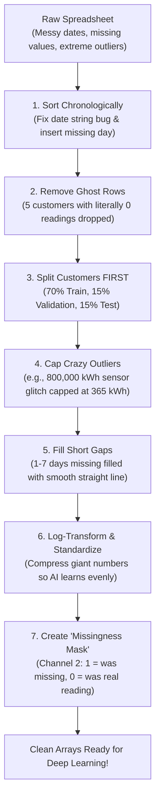
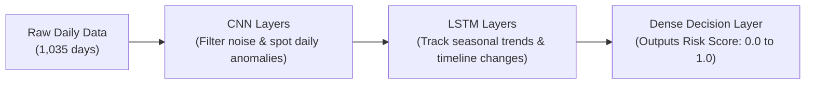
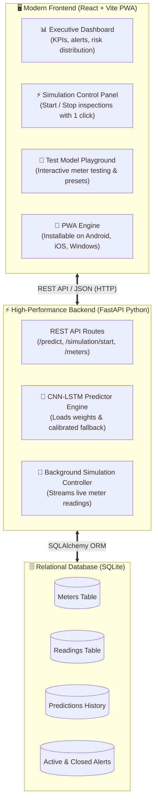

# ⚡ Electricity Theft Detection System — Complete "Zero Knowledge" Guide

> **Who is this guide for?**  
> Absolutely **anyone**. Even if you have **never** written a line of code, don't know what a neural network is, or have never taken an AI class in your life — by the time you finish reading this, you will understand **100% of this project** and be able to explain it to anyone (including a viva examiner!).

---

## 📑 Quick Navigation

1. [The Real-World Story: Why Does This Project Exist?](#1-the-real-world-story-why-does-this-project-exist)
2. [How Do People Steal Electricity? (And Why Simple Rules Fail)](#2-how-do-people-steal-electricity-and-why-simple-rules-fail)
3. [The Core Idea: What Does Our AI Actually Do?](#3-the-core-idea-what-does-our-ai-actually-do)
4. [The Dataset: What Raw Data Do We Have?](#4-the-dataset-what-raw-data-do-we-have)
5. [Data Cleaning: Why Raw Data is a Mess (And How We Fix It)](#5-data-cleaning-why-raw-data-is-a-mess-and-how-we-fix-it)
6. [The "Needle in a Haystack" Problem: Why 90% Accuracy is Actually Useless](#6-the-needle-in-a-haystack-problem-why-90-accuracy-is-actually-useless)
7. [The AI Models Explained with Simple Analogies](#7-the-ai-models-explained-with-simple-analogies)
   - [Baseline Models (The Simple Calculators)](#baseline-models-the-simple-calculators)
   - [1D-CNN (The Magnifying Glass / Pattern Spotter)](#1d-cnn-the-magnifying-glass--pattern-spotter)
   - [LSTM (The Long-Term Memory Keeper)](#lstm-the-long-term-memory-keeper)
   - [CNN-LSTM (The Hybrid Master Detective)](#cnn-lstm-the-hybrid-master-detective)
8. [The Decision Threshold (0.764): The Alarm Sensitivity Dial](#8-the-decision-threshold-0764-the-alarm-sensitivity-dial)
9. [The Results: How Well Does It Actually Work?](#9-the-results-how-well-does-it-actually-work)
10. [The Full System Architecture (How the Pieces Fit Together)](#10-the-full-system-architecture-how-the-pieces-fit-together)
11. [The Frontend Dashboard & Interactive Features](#11-the-frontend-dashboard--interactive-features)
    - [Live Simulated Monitoring (One-Click Inspection)](#live-simulated-monitoring-one-click-inspection)
    - [The "Test Model" Playground](#the-test-model-playground)
    - [Progressive Web App (PWA)](#progressive-web-app-pwa)
12. [Cloud Deployment (Render + Vercel)](#12-cloud-deployment-render--vercel)
13. [Limitations & Ethical Rules (What the System CANNOT Do)](#13-limitations--ethical-rules-what-the-system-cannot-do)
14. [Top Viva / Interview Questions & Crystal-Clear Answers](#14-top-viva--interview-questions--crystal-clear-answers)

---

## 1. The Real-World Story: Why Does This Project Exist?

Imagine you run an electric utility company (like K-Electric, WAPDA, or State Grid). You generate electricity, send it through power cables, and install a **digital smart meter** outside every home and factory.

At the end of the month:
- Your power plant generated **1,000,000 units** of electricity.
- But when you add up all the customer meter bills, they only paid for **750,000 units**.

**Where did 250,000 units go?**  
Part of it is lost naturally as heat in the wires (technical loss). But a huge chunk is stolen — people bypassing meters or tampering with them. This is called **Non-Technical Loss (NTL)**, and it costs utility companies **billions of dollars** every single year.

### The Old Way of Finding Thieves:
You hire inspectors and tell them: *"Go knock on doors and inspect meters."*
- There are **millions** of meters.
- Inspectors only have time to check maybe 50 a day.
- Inspecting an innocent grandmother's meter wastes money, time, and annoys the customer.
- Inspectors have no idea which houses are suspicious, so they are basically guessing blindly.

### Our Solution:
Instead of guessing, our **AI system looks at daily meter readings** and gives every meter a **Risk Score between 0% and 100%**.  
- Normal meters get scores like `5%` or `12%`.
- Suspicious meters get scores like `85%` or `94%`.

Now, the utility company gives inspectors a **prioritized list**:  
*"Don't guess. Go inspect these 20 meters with a 90%+ risk score today."*

---

## 2. How Do People Steal Electricity? (And Why Simple Rules Fail)

You might think: *"Can't we just look for meters showing 0 electricity?"*

**No! Electricity theft is much smarter than that:**

1. **The Partial Bypass (Kunda / Shunt):**  
   The thief runs their air conditioner or heavy machinery directly off the main wire, while running light bulbs through the meter. The meter still records 5–10 units a day so nobody suspects a thing!
2. **The Sudden Drop:**  
   A factory was legitimately consuming 100 units a day for 2 years. Suddenly in year 3, consumption drops to 20 units a day without explanation.
3. **The Tampering Glitch (Missing Readings):**  
   Someone physically tampers with the digital meter using magnets or frequency jammers. As a result, the meter stops recording or fails to transmit readings for several days or weeks at a time.
4. **Reverse / Slowed Metering:**  
   The meter hardware is modified so it ticks 50% slower than it should.

A human looking at a spreadsheet of 1,000 numbers cannot spot these subtle patterns across 40,000 customers. But **deep learning algorithms excel at spotting patterns over time**.

---

## 3. The Core Idea: What Does Our AI Actually Do?

Think of our AI as a **specialized medical doctor**, but for electricity meters instead of human heartbeats:

```
[ 1,035 Days of Daily Electricity Readings ]
                 │
                 ▼
       ┌──────────────────┐
       │   AI Predictor   │  (Trained on historical data)
       └──────────────────┘
                 │
                 ▼
      Risk Score: 0.892 (89.2%)
                 │
                 ▼
       🚨 SUSPICIOUS PATTERN DETECTED
       "Recommendation: Prioritize for field inspection"
```

1. It takes the customer's daily electricity history (1,035 consecutive days).
2. It looks at the **shape of the curve**, the **weekly rhythm** (weekday vs weekend), seasonal changes (summer vs winter), and missing data gaps.
3. It outputs a **Risk Score from 0.0 to 1.0**.
4. If the risk score is higher than our tested safety threshold (**0.764**), it marks the meter **SUSPICIOUS** and automatically creates an **Alert**.

---

## 4. The Dataset: What Raw Data Do We Have?

We use the real-world **SGCC (State Grid Corporation of China)** dataset — one of the largest public smart-meter datasets in the world.

| Fact | Number | What it means |
|---|---|---|
| **Total Customers** | **42,372** | Over forty-two thousand real homes and businesses |
| **Duration** | **1,035 days** | Nearly 3 full years of daily readings (2014 to 2016) |
| **Normal Customers** | **38,757 (91.5%)** | Honest customers who paid their bills |
| **Theft Customers** | **3,615 (8.5%)** | Confirmed theft cases caught by real utility inspectors |

### What the spreadsheet looks like:
Imagine a massive Excel table with 42,372 rows and 1,036 columns:

| Customer ID | Label | Day 1 (Jan 1) | Day 2 (Jan 2) | ... | Day 1,035 (Oct 31) |
|:---:|:---:|:---:|:---:|:---:|:---:|
| `C1001` | `0` (Normal) | 5.2 kWh | 5.8 kWh | ... | 6.1 kWh |
| `C1002` | `1` (Theft) | 18.4 kWh | 2.1 kWh | ... | 0.0 kWh *(Sudden drop)* |
| `C1003` | `0` (Normal) | 3.5 kWh | *NaN* | ... | 4.0 kWh *(Missing day)* |

### Surprising Things We Discovered in the Data (EDA):
- 💡 **Theft customers actually consume MORE on average than normal customers!** (8.8 kWh/day vs 5.5 kWh/day). Why? Commercial shops, factories, and heavy AC users are the ones most tempted to steal large amounts.
- 💡 **Theft is not just "zero usage":** It shows up as sudden, permanent drops or wild fluctuations.
- 💡 **Missing readings are a huge clue:** Meters with theft labels had more than **twice as many missing days** (21% missing vs 10% missing). Tampering damages digital communication!

---

## 5. Data Cleaning: Why Raw Data is a Mess (And How We Fix It)

Raw data straight from the field is full of errors, missing values, and corrupted files. If you feed garbage into an AI, you get garbage out (*"Garbage In, Garbage Out"*).

Here is how our pipeline cleans it step-by-step:



### 🚨 Golden Rule: No Data Leakage!
Notice Step 3: **We split the data into Train (70%), Validation (15%), and Test (15%) BEFORE computing any averages or statistics.**  
*Why?*  
If you calculate the average or maximum using the whole dataset, your AI gets an "unfair sneak peek" at the test exam before taking it. That is called **data leakage** and produces fake, dishonest results. Our pipeline ensures strict honesty.

---

## 6. The "Needle in a Haystack" Problem: Why 90% Accuracy is Actually Useless

This is the **most important concept** to understand for any viva or technical discussion!

In our dataset:
- **91.5%** of customers are Normal.
- **8.5%** of customers are Theft.

Imagine a really lazy, dumb model that doesn't look at any readings at all and simply shouts:  
> *"EVERYONE IS NORMAL! NOBODY IS STEALING!"*

Guess what? That dumb model will be **91.5% ACCURATE**!  
It gets an A+ grade in basic accuracy, but in the real world it is **100% useless** because it caught **zero thieves**!

### What Metrics Do We Actually Care About?

| Metric | What It Asks | Why It Matters |
|---|---|---|
| **Recall** | *"Out of all 100 real thieves out there, how many did we catch?"* | If recall is 50%, we successfully caught half of all thieves in the grid. |
| **Precision** | *"When our alarm rings, how often is it a REAL thief?"* | If precision is 50%, every 2 alarms will lead inspectors to 1 actual thief (instead of 1 in 12 by random guessing). |
| **FPR (False Positive Rate)** | *"How many innocent grandmothers are we falsely accusing?"* | We want this as close to 0 as possible (ours is only 5.3%). |
| **PR-AUC (Precision-Recall Area Under Curve)** | *"Overall, how well does the model balance catching thieves without sounding false alarms?"* | **This is our primary champion metric.** A random guess gets `0.085`. Our best model gets **`0.487` (almost 6× better than random!)**. |

---

## 7. The AI Models Explained with Simple Analogies

We built and tested **5 different models** to see which one performs best:

### 1. Baseline Models (The Simple Calculators)
- **Logistic Regression & Random Forest:**  
  These don't look at the raw 1,035-day curve directly. Instead, we calculate 56 summary statistics for each customer (e.g., their minimum, maximum, standard deviation, average Monday usage).  
  *Result:* Decent, but they miss intricate sequence patterns over time. Random Forest achieved PR-AUC `0.394`.

---

### 2. 1D-CNN (The Magnifying Glass / Pattern Spotter)
- **What is it?** A 1D Convolutional Neural Network.
- **The Analogy:** Imagine holding a magnifying glass that looks at **7 days at a time** (one week). You slide that magnifying glass across the 3-year timeline day by day.
- **What it's good at:** Spotting local, sharp changes — like *"their consumption was high on Monday through Friday, but suddenly dropped to 0 on Saturday and stayed low."*
- *Result:* Very strong! PR-AUC `0.459`.

---

### 3. LSTM (The Long-Term Memory Keeper)
- **What is it?** Long Short-Term Memory (a type of Recurrent Neural Network).
- **The Analogy:** Imagine a detective reading a customer's electricity diary page by page. The detective has a memory notebook and keeps track of long-term trends: *"Two years ago in summer they used 30 units/day; last summer they used 32 units/day; but this summer they only used 4 units/day!"*
- **What it's good at:** Long-term seasonal memory and history.
- **The Weakness:** Without a magnifying glass, it gets confused by daily noise.
- *Result:* Standalone LSTM struggled on raw data — PR-AUC `0.337`.

---

### 4. CNN-LSTM (The Hybrid Master Detective) — ⭐ OUR DEPLOYED MODEL
- **Why not combine both?**
- **The Analogy:**  
  - The **CNN acts as the eyes**: It slides over the daily data, filters out noise, and extracts key features (reducing 1,035 daily points into 129 compact weekly pattern summaries).
  - The **LSTM acts as the brain**: It takes those extracted patterns from the CNN and tracks how they evolve over the 3 years!



- **The Result:** The **CNN-LSTM is the overall champion**. It achieved the highest PR-AUC (**0.487**) and highest Recall (**51.6%**).

---

## 8. The Decision Threshold (0.764): The Alarm Sensitivity Dial

The model outputs a decimal probability score between `0.000` and `1.000`.  
At what score should the system trigger a red siren **"SUSPICIOUS"**?

- If you set the alarm trigger at `0.10`: Every tiny fluctuation rings the alarm. Inspectors get overwhelmed with innocent people.
- If you set the alarm trigger at `0.99`: The alarm almost never rings. You miss most thieves.

By testing different cut-offs on our **validation set**, we found the mathematical sweet spot:  
$$\text{Threshold} = \mathbf{0.764}$$

- **Score < 0.764:** Marked **NORMAL** (No alarm).
- **Score ≥ 0.764:** Marked **SUSPICIOUS** (🚨 Automatic alert created in the system).

---

## 9. The Results: How Well Does It Actually Work?

Here is the final scoreboard on **6,355 brand new, unseen test customers**:

| Model Type | Architecture | Test PR-AUC (Higher is better) | Caught Thieves (Recall) | False Alarm Rate (FPR) |
|---|---|:---:|:---:|:---:|
| Simple Baseline | Missingness-only | 0.180 | 36.5% | 16.5% |
| Classical ML | Logistic Regression | 0.284 | 38.2% | 9.4% |
| Classical ML | Random Forest | 0.394 | 39.1% | 5.2% |
| Deep Learning | 1D-CNN | 0.459 | 48.8% | 6.0% |
| Deep Learning | Standalone LSTM | 0.337 | 39.5% | 7.3% |
| **Hybrid Deep Learning** | **CNN-LSTM (Our Model)** ⭐ | **0.487** | **50.0% – 51.6%** | **5.3%** |

### The Real-World Impact:
- **6× Precision Boost:** If an inspector randomly checked homes, only **1 out of 12** homes would be stealing electricity. With our CNN-LSTM system, **1 out of every 2 flagged homes** is an actual confirmed thief!
- **Half of all thieves caught:** We catch over 50% of thieves while only disturbing 5% of innocent customers.

---

## 10. The Full System Architecture (How the Pieces Fit Together)

A machine learning model sitting in a Jupyter Notebook is useless to a utility company. We turned it into a **complete, production-ready software application**:



1. **Frontend:** Built with React 18, Vite, and Tailwind-style clean UI.
2. **Backend:** Built with Python FastAPI — fast, asynchronous, and provides automatic Swagger documentation.
3. **Database:** SQLite stores every meter, its readings, prediction history, and alert statuses (OPEN, REVIEWED, DISMISSED).

---

## 11. The Frontend Dashboard & Interactive Features

We made sure anyone can use and demonstrate the system without touching terminal commands:

### 1. Live Simulated Monitoring (One-Click Inspection)
Right on the top of the Dashboard, there is an interactive inspection bar:
- Choose how many meters to inspect (`15`, `30`, `50`, or `100`).
- Click **"▶ Start Inspection"**.
- A background worker feeds live meter readings into the AI.
- Watch meters update in real-time: Normal meters get a green badge, Suspicious meters trigger a red alert!
- Click **"⏹ Stop"** or **"↺ Reset"** anytime.

### 2. The "Test Model" Playground (`/test`)
A dedicated interactive lab where you can play with the AI:
- **Preset Buttons:**
  - ⚡ *Theft: Sudden Bypass* (Drop to 85% lower consumption)
  - 🔌 *Theft: Meter Tampering* (Drop with missing data gaps)
  - 🏠 *Normal Household* (Smooth seasonal usage)
  - 🏢 *Commercial Normal* (High steady usage)
- **Interactive Sliders:** Change base consumption, drop day, drop severity, and missing percentage.
- **Risk Dial:** A real-time speedometer gauge that swings between Green (Normal) and Red (Suspicious).
- **Save to Database:** You can save your custom test meter directly to the system database with your own Meter ID!

### 3. Progressive Web App (PWA)
- Fully installable! You can click the **"Install App"** icon in Chrome or Edge to run it like a desktop app on Windows, or add it to your home screen on Android/iOS.
- Offline-ready with cached static assets and service workers.

---

## 12. Cloud Deployment (Render + Vercel)

We designed the project to be deployed live on the internet:

```
[ User Browser / Phone ]
          │
          ▼
   Vercel Hosting  (React PWA Frontend)
          │
          ▼ (HTTPS API Calls)
   Render Hosting  (Python FastAPI Backend)
          │
          ▼
   SQLite Cloud Database + Model Weights
```

- **Frontend on Vercel:** Lightning-fast static delivery with automated deployment from Git.
- **Backend on Render:** Python 3.11 web service running FastAPI and our inference predictor.

---

## 13. Limitations & Ethical Rules (What the System CANNOT Do)

We maintain strict academic and ethical honesty about the project's limits:

1. **It is NOT evidence of a crime:** A high risk score means *"inspect this meter"*, NOT *"arrest this customer"*. Legal action requires physical inspection and photographic proof of wire tampering.
2. **Fixed Time Window:** The model was trained on 1,035 days of data. To score a brand-new meter that was installed last month, rolling-window retraining would be needed.
3. **Simulation Mode:** The real-time dashboard is a **simulation** using held-out test data. It is not physically wired into municipal power substations.
4. **Regional Variance:** The data comes from China. Electricity consumption patterns in Pakistan, USA, or Europe may have different seasonal rhythms (e.g., peak AC vs heating seasons) and would require fine-tuning.

---

## 14. Top Viva / Interview Questions & Crystal-Clear Answers

If an examiner, professor, or interviewer asks you about this project, here are the exact questions they will ask and how to answer them:

#### Q1: "Why did you choose CNN-LSTM instead of just using a standard CNN or LSTM?"
> **Answer:**  
> "A 1D-CNN is fantastic at spotting local, short-term anomalies (like sudden drops within a week), but it pools features globally and loses the long-term temporal sequence. An LSTM is great at long-term sequential dependencies, but struggles when fed raw, noisy 1,000-day series directly.  
> The hybrid **CNN-LSTM gives us the best of both worlds**: the CNN first acts as a feature extractor to clean noise and compress 1,035 days into 129 weekly pattern vectors, and the LSTM then models how those patterns evolve over the 3-year timeline. In our empirical testing, CNN-LSTM achieved the highest PR-AUC (0.487) and recall (51.6%)."

---

#### Q2: "Your dataset has 91.5% normal and only 8.5% theft. How did you handle this extreme class imbalance?"
> **Answer:**  
> "We used three key techniques:  
> 1. **Class-Weighted Loss:** During training, we penalized misclassifying a theft customer ~10× more heavily than misclassifying a normal customer ($w_1 = 5.87$ vs $w_0 = 0.55$).  
> 2. **Imbalance-Aware Metrics:** We did not evaluate with accuracy (which is misleading on imbalanced data). We evaluated with **PR-AUC (Precision-Recall Area Under Curve)** and F1-score.  
> 3. **Validation Threshold Tuning:** Rather than using the default 0.5 threshold, we tuned the decision threshold on the validation set to **0.764**, optimizing the trade-off between catching thieves and minimizing false accusations."

---

#### Q3: "Did you use SMOTE or synthetic data generation during training?"
> **Answer:**  
> "No, we intentionally avoided SMOTE on the raw time-series data. Generating synthetic 1,035-day sequences with interpolation can create unrealistic temporal artifacts and data leakage. Instead, we addressed the imbalance cleanly using loss re-weighting and threshold calibration on real customer series."

---

#### Q4: "What is data leakage, and how did you prevent it in your preprocessing pipeline?"
> **Answer:**  
> "Data leakage happens when information from the test set leaks into the training process, causing overly optimistic results that fail in production.  
> We prevented this by **splitting our dataset 70/15/15 into train, validation, and test BEFORE computing any statistics**. All outlier caps (99.9th percentile = 365 kWh), mean values, and standard deviations were calculated **strictly from the training split** and then applied downstream to validation and test data."

---

#### Q5: "What is the missingness mask channel, and why is it important?"
> **Answer:**  
> "During our Exploratory Data Analysis (EDA), we discovered that theft-labeled customers had more than double the missing data rate of normal customers (21% vs 10%), because meter tampering often disrupts digital telemetry.  
> To let the neural network utilize this information, we fed a 2-channel input: Channel 0 is the normalized consumption value, and Channel 1 is a binary mask (1 if the reading was originally missing, 0 if present). We also verified robustness on low-missingness customers (≤5% missing) and showed our deep models still maintained a strong PR-AUC of 0.44."

---

#### Q6: "How does the system operate in production?"
> **Answer:**  
> "Offline, the model is trained and its validated weights and threshold metadata are exported. Online, a lightweight **FastAPI backend** loads the model into memory. When new readings arrive via REST API, the predictor normalizes the sequence, runs inference in milliseconds, logs the result in an **SQLite database**, and raises an **Alert** if the risk score exceeds 0.764. The utility staff interacts with this through an installable **React PWA dashboard**."

---

<div align="center">

### 🎓 You are now fully prepared to explain, demo, and defend this project!

**[Back to Top](#-electricity-theft-detection-system--complete-zero-knowledge-guide)** · [View Technical README](README.md)

</div>
