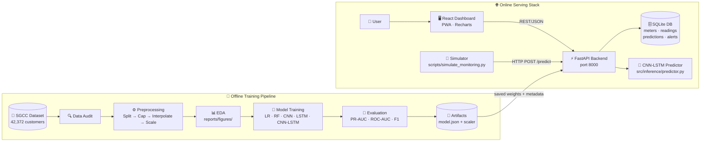
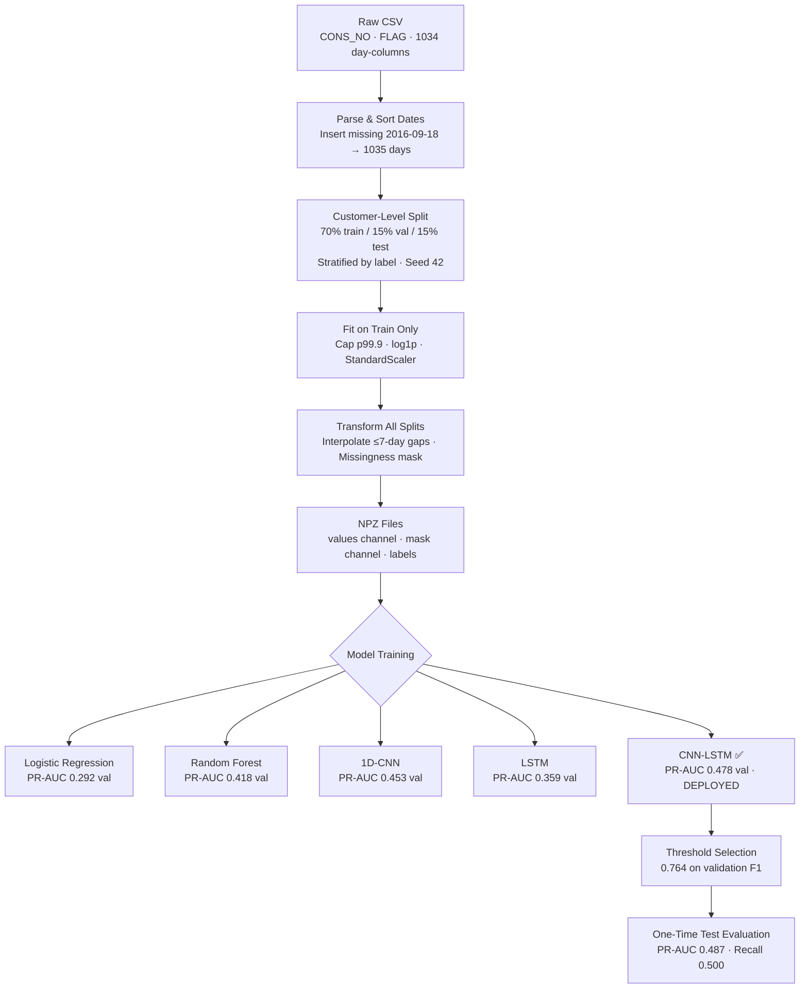
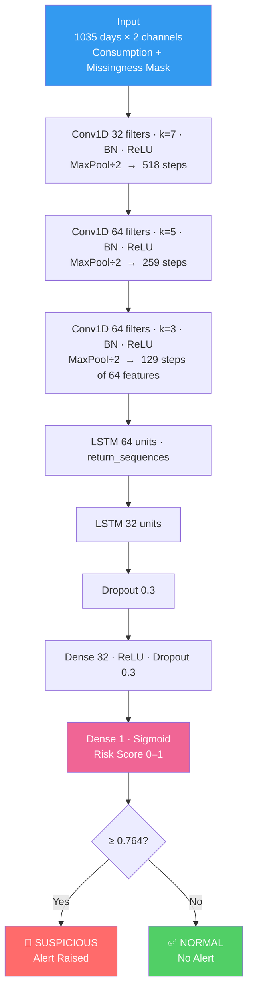
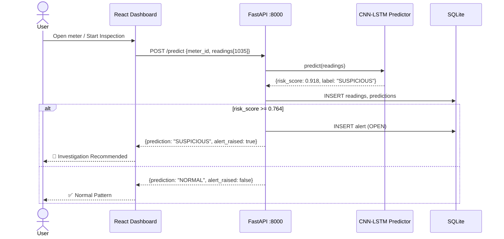

<div align="center">

# ⚡ AI-Based Electricity Theft Detection System

### CNN-LSTM Deep Learning · FastAPI Backend · React PWA Dashboard

<br/>


<br/>


<br/>

> 🔍 A decision-support system that flags **suspicious electricity-consumption patterns** in smart-meter data for investigation.
> A prediction is **not** proof of theft — it is a risk indicator to prioritise field inspections.

<br/>

**Deployed Model:** CNN-LSTM (seed 1) · Test PR-AUC **0.487** · Recall **0.500** · FPR **0.053** · Threshold **0.764**

</div>

---

## 📋 Table of Contents

| # | Section |
|---|---------|
| 1 | [Project Overview](#1-project-overview) |
| 2 | [Problem Statement](#2-problem-statement) |
| 3 | [Objectives](#3-objectives) |
| 4 | [System Architecture](#4-system-architecture) |
| 5 | [Dataset](#5-dataset) |
| 6 | [Data Preprocessing](#6-data-preprocessing) |
| 7–9 | [Model Architectures](#7-cnn-architecture) |
| 10 | [Training Procedure](#10-training-procedure) |
| 11 | [Evaluation Methodology](#11-evaluation-methodology) |
| 12 | [📊 Results](#12-results) |
| 13 | [Backend API](#13-backend-api) |
| 14 | [Frontend Dashboard](#14-frontend-dashboard) |
| 15 | [Simulated Monitoring](#15-simulated-real-time-monitoring) |
| 16–19 | [Quick Start](#16-installation) |
| 20 | [Limitations](#20-limitations) |
| 21 | [Future Work](#21-future-work) |

---

## 1. Project Overview

The system analyses **time-series of smart-meter consumption** and assigns each meter a **risk score (0–1)** and a classification of **NORMAL** or **SUSPICIOUS**.

The proposed model is a hybrid **CNN-LSTM** — convolutional blocks extract local temporal patterns; LSTM layers model how those patterns evolve over time. It is benchmarked against Logistic Regression, Random Forest, stand-alone 1D-CNN, and stand-alone LSTM.

Results are served through a **FastAPI** REST backend and a **React PWA dashboard** with simulated real-time monitoring, alert management, and model performance visualisation.

---

## 2. Problem Statement

Non-technical losses — including electricity theft — cost utilities billions in lost revenue annually. Manual inspection is expensive and unscalable. Key challenges:

- 🏷️ **Label scarcity & imbalance** — only 8.5% of customers are theft-labelled
- 📉 **Noisy data** — 25.6% of readings are missing; extreme outliers exist
- ⚠️ **False alert cost** — wrongly flagging an honest customer causes harm
- 🌍 **Generalisation** — patterns from one region may not transfer elsewhere

---

## 3. Objectives

1. Audit and preprocess a public labelled smart-meter dataset without data leakage
2. Establish baselines (Logistic Regression, Random Forest, missingness heuristic)
3. Implement and compare 1D-CNN, LSTM and CNN-LSTM classifiers
4. Evaluate with **imbalance-aware metrics** and select a threshold on the validation set
5. Serve the selected model through a **REST API** that stores predictions and alerts
6. Build a **dashboard** for monitoring, meter drill-down, alerts and model performance
7. Document the methodology so it can be explained in the viva

---

## 4. System Architecture

### High-Level Overview



### Pipeline Flow



### Model Architecture



### Request Lifecycle



---

## 5. Dataset

**SGCC** (State Grid Corporation of China) — public labelled smart-meter dataset.
Full audit: [`reports/audit/dataset_audit.md`](reports/audit/dataset_audit.md) | Details: [`data/README.md`](data/README.md)

| Property | Value |
|---|---|
| Total customers | 42,372 |
| Time window | 2014-01-01 → 2016-10-31 |
| Days per customer | 1,035 (one missing day inserted) |
| Theft-labelled | 3,615 (8.53%) |
| Normal-labelled | 38,757 (91.47%) |
| Missing readings | 25.6% overall; median 1.4% after first reading |
| Extreme outlier | Max 800,003 kWh (99.9th pct: 372 kWh) |

<details>
<summary>📊 EDA Key Findings (click to expand)</summary>

- **Theft consumes more, not less**: median 8.8 vs 5.5 kWh/day — theft appears as *sudden drops*, not low consumption
- **Missingness is a signal**: theft-labelled customers have 2.2× the median missing fraction (0.21 vs 0.10)
- **Data-quality days**: 2014-10-03 is ~99% missing; 2016-09-18 absent from file entirely
- **Weekly cycle**: weekend consumption is 1–2% above weekly mean — motivates k=7 CNN kernel
- **Label noise visible**: some normal-labelled customers show 0 kWh every day

> ⚠️ Validation and test customers are excluded from EDA — no data leakage possible.

</details>

---

## 6. Data Preprocessing

**Code:** [`src/preprocessing/pipeline.py`](src/preprocessing/pipeline.py) · **Script:** `python scripts/preprocess.py`

| Step | Action | Anti-Leakage |
|---|---|---|
| 1 | Parse date columns, sort chronologically, insert 2016-09-18 as missing | — |
| 2 | Coerce invalid readings to `NaN`; drop 5 all-missing customers | — |
| **3** | **Split 70/15/15 train/val/test, stratified by label** | ✅ Split happens FIRST |
| 4 | Cap at 99.9th percentile of **training** readings (365.0 kWh) | ✅ Fitted on train only |
| 5 | Interpolate interior gaps ≤ 7 days using the customer's own series | — |
| 6 | `log1p` → standardise with **training** mean/std; gaps → 0 | ✅ Fitted on train only |
| 7 | Keep **missingness mask** as channel 2 (1 = originally missing) | — |

**Outputs:** `data/processed/{train,val,test}.npz`, `artifacts/scalers/preprocessor.json`, `artifacts/metadata/preprocessing_summary.json`

---

## 7. CNN Architecture

<details>
<summary>View CNN details</summary>

**Code:** [`src/models/deep.py`](src/models/deep.py) (`build_cnn`) · Input shape: **(1036, 2)** · Parameters: **27,777**

```
Conv1D(32, k=7) → BN → ReLU → MaxPool(2)      ← k=7 spans one week (EDA weekly cycle)
Conv1D(64, k=5) → BN → ReLU → MaxPool(2)
Conv1D(64, k=3) → BN → ReLU → MaxPool(2)
[GlobalAvgPool ‖ GlobalMaxPool] → Dropout(0.3) → Dense(32, ReLU) → Dropout(0.3) → Dense(1, sigmoid)
```

Training: `python scripts/train_deep.py --model cnn` · Best epoch: 39/40 · CPU time: ~28 min

</details>

---

## 8. LSTM Architecture

<details>
<summary>View LSTM details</summary>

**Code:** [`src/models/deep.py`](src/models/deep.py) (`build_lstm`) · Parameters: **33,729**

Input **(1036, 2)** is reshaped internally to **148 weekly steps × 14 features** (7 days × [value, mask]).
Running LSTM over 1,036 daily steps is slow and struggles with long dependencies — weekly reshaping fixes both.

```
Reshape(148, 14) → LSTM(64, return_sequences) → LSTM(32) → Dropout(0.3) → Dense(32, ReLU) → Dropout(0.3) → Dense(1, sigmoid)
```

Training: `python scripts/train_deep.py --model lstm` · Best epoch: 38/40 · CPU time: ~23 min

> ⚠️ **Weakest deep model** (val PR-AUC 0.359) — without convolutional feature extraction, it struggles to detect sudden drops from raw weekly inputs. This motivates the hybrid CNN-LSTM.

</details>

---

## 9. CNN-LSTM Architecture (Proposed & Deployed)

**Code:** [`src/models/deep.py`](src/models/deep.py) (`build_cnn_lstm`) · Parameters: **70,145**

The CNN blocks extract local patterns and compress the sequence 8× (1,036 → 129 steps of 64 features). LSTM layers then model how those patterns evolve over the full period — replacing the CNN's order-blind global pooling.

```
Conv1D(32, k=7) → BN → ReLU → MaxPool(2)
Conv1D(64, k=5) → BN → ReLU → MaxPool(2)
Conv1D(64, k=3) → BN → ReLU → MaxPool(2)      →  (129, 64)
LSTM(64, return_sequences) → LSTM(32) → Dropout(0.3) → Dense(32, ReLU) → Dropout(0.3) → Dense(1, sigmoid)
```

Training: `python scripts/train_deep.py --model cnn_lstm` · Best epoch: 30/36 · CPU time: ~83 min

---

## 10. Training Procedure

| Setting | Value |
|---|---|
| Loss | Binary Cross-Entropy |
| Optimiser | Adam, lr = 1e-3 |
| Batch size | 128 |
| Max epochs | 40 |
| Early stopping | Patience 6 · monitors val PR-AUC · restores best weights |
| LR scheduler | ReduceLROnPlateau (factor 0.5, patience 3) |
| Class weights | {normal: 0.55, theft: 5.87} |
| Random seed | 42 (+ seeds 1, 2 for CNN and CNN-LSTM) |
| Baselines | LR (C ∈ {0.01, 0.1, 1}), RF (400 trees, balanced_subsample) |

---

## 11. Evaluation Methodology

- **Metrics:** Accuracy, Precision, Recall, F1, **PR-AUC** (primary), ROC-AUC, FPR, Confusion Matrix
- **Test set used exactly once** — model selection and threshold chosen on validation only
- **Multi-seed robustness:** CNN and CNN-LSTM each trained with 3 seeds; reported as mean ± std
- **Missingness robustness:** separate evaluation on customers with ≤ 5% missing readings
- **Model selection rule** (pre-registered before test scores seen):
  1. Highest mean validation PR-AUC across seeds → deployed architecture
  2. Best single-seed val PR-AUC → deployed weights
  3. Val threshold → written to `artifacts/metadata/model.json` before any test scoring

---

## 12. Results

### Validation Results

> PR-AUC baseline (random classifier) ≈ **0.085** (8.5% positive rate)

| Model | Accuracy | Precision | Recall | F1 | PR-AUC | ROC-AUC | FPR |
|---|:---:|:---:|:---:|:---:|:---:|:---:|:---:|
| Missingness-only LR (heuristic) | 0.803 | 0.186 | 0.387 | 0.251 | 0.170 | 0.665 | 0.158 |
| Logistic Regression | 0.865 | 0.298 | 0.426 | 0.351 | 0.292 | 0.773 | 0.094 |
| Random Forest | 0.904 | 0.440 | 0.448 | 0.444 | 0.418 | 0.828 | 0.053 |
| 1D-CNN | 0.913 | 0.488 | 0.520 | 0.504 | 0.453 | **0.849** | **0.051** |
| LSTM | 0.885 | 0.361 | 0.450 | 0.401 | 0.359 | 0.795 | 0.074 |
| **CNN-LSTM** ✅ | 0.899 | 0.428 | **0.548** | 0.481 | **0.478** | 0.832 | 0.068 |

**Extra seeds (val PR-AUC):**
- 1D-CNN: 0.453 / 0.448 / 0.444 → mean **0.448 ± 0.004**
- CNN-LSTM: 0.478 / **0.495** / 0.461 → mean **0.478 ± 0.017** ← **selected**

Deployed: **CNN-LSTM seed 1** (val PR-AUC 0.495, threshold 0.764)

---

### Final Test Results

> Test split: 6,355 customers · 8.5% positive · Random PR-AUC ≈ **0.085**

| Model | Accuracy | Precision | Recall | F1 | PR-AUC | ROC-AUC | FPR |
|---|:---:|:---:|:---:|:---:|:---:|:---:|:---:|
| Missingness-only LR | 0.795 | 0.171 | 0.365 | 0.233 | 0.180 | 0.677 | 0.165 |
| Logistic Regression | 0.861 | 0.274 | 0.382 | 0.319 | 0.284 | 0.774 | 0.094 |
| Random Forest | 0.900 | 0.411 | 0.391 | 0.401 | 0.394 | 0.828 | 0.052 |
| 1D-CNN (3 seeds) | 0.901 ± 0.007 | 0.432 ± 0.030 | 0.488 ± 0.013 | 0.458 ± 0.012 | 0.459 ± 0.011 | **0.847 ± 0.007** | **0.060 ± 0.009** |
| LSTM | 0.882 | 0.335 | 0.395 | 0.362 | 0.337 | 0.795 | 0.073 |
| **CNN-LSTM (3 seeds)** | 0.899 ± 0.009 | 0.427 ± 0.037 | **0.516 ± 0.015** | **0.466 ± 0.017** | **0.475 ± 0.016** | 0.834 ± 0.005 | 0.065 ± 0.011 |
| ⭐ *Deployed: CNN-LSTM seed 1* | **0.909** | **0.469** | 0.500 | **0.484** | **0.487** | 0.838 | **0.053** |

**Confusion Matrix (deployed model, test):**

```
                     Predicted
                  NORMAL   SUSPICIOUS
Actual NORMAL    5,506  │    307      (FPR = 0.053)
       THEFT       271  │    271      (Recall = 0.500)
```

> 🎯 Roughly **1 in 2 flagged customers is theft-labelled** — versus 1 in 12 at random (**6× lift**).

<details>
<summary>📊 Missingness Robustness Results (customers with ≤ 5% missing, click to expand)</summary>

> n = 2,756 customers · 5.8% positive · Random PR-AUC ≈ 0.058

| Model | PR-AUC | ROC-AUC | Recall | FPR |
|---|:---:|:---:|:---:|:---:|
| Missingness-only LR | 0.132 | 0.679 | 0.138 | 0.017 |
| Logistic Regression | 0.199 | 0.785 | 0.319 | 0.083 |
| Random Forest | 0.294 | 0.837 | 0.306 | 0.040 |
| 1D-CNN (3 seeds) | 0.442 ± 0.005 | 0.875 ± 0.011 | 0.458 ± 0.019 | 0.045 ± 0.008 |
| LSTM | 0.315 | 0.809 | 0.369 | 0.057 |
| CNN-LSTM (3 seeds) | **0.440 ± 0.016** | 0.840 ± 0.007 | **0.525 ± 0.027** | 0.053 ± 0.008 |

✅ Deep models maintain PR-AUC ~0.44 (7.6× random) even without missing-data signal — the missingness-only baseline falls to 0.132. The model learns real consumption behaviour, not just data artefacts.

</details>

<details>
<summary>🔎 Error Analysis (deployed model, click to expand)</summary>

| Group | n | Missing Fraction | Mean Consumption | Risk Score |
|---|:---:|:---:|:---:|:---:|
| True Positives | 271 | 0.224 | 0.505 | 0.963 |
| False Positives | 307 | 0.177 | 0.274 | 0.885 |
| False Negatives | 271 | 0.243 | 0.154 | 0.290 |
| True Negatives | 5,506 | 0.088 | 0.066 | 0.054 |

- **False alarms** have 2× the missing data of true negatives — the model partly treats "large and gappy" as risky
- **Missed cases** consume less than detected ones — low-consumption theft is harder to find
- Some false positives may be undetected theft (label noise from inspection-based labels)

</details>

---

## 13. Backend API

**FastAPI** (`backend/app/`) · Single process · Single SQLite file · `src/inference/predictor.py`

The API **never trains** — inference only. All scoring uses the deployed CNN-LSTM weights and the validated threshold from `artifacts/metadata/model.json`.

| Method | Endpoint | Purpose |
|---|---|---|
| `GET` | `/health` | Liveness check; reports whether model is loaded |
| `POST` | `/predict` | Score one consumption sequence |
| `POST` | `/predict/batch` | Score several sequences |
| `GET` | `/meters` | List monitored meters with latest status |
| `GET` | `/meters/{meter_id}` | Meter detail: readings, prediction history, alerts |
| `GET` | `/alerts` | Alert history (filter: `status`, `min_risk`) |
| `PATCH` | `/alerts/{id}` | Set status: `OPEN` / `REVIEWED` / `DISMISSED` |
| `GET` | `/dashboard/summary` | Counts and distributions for the dashboard |
| `GET` | `/model/metrics` | Stored evaluation results for Model Performance page |
| `GET` | `/simulation/status` | Current simulation state and progress |
| `POST` | `/simulation/start` | Start background simulation (`?meter_count=N`) |
| `POST` | `/simulation/stop` | Stop running simulation |
| `POST` | `/simulation/reset` | Reset all simulation data |

**Example request / response:**

```bash
curl -X POST http://127.0.0.1:8000/predict \
  -H "Content-Type: application/json" \
  -d '{"meter_id": "M001", "readings": [4.2, 3.8, null, 5.1, ...]}'
```

```json
{
  "meter_id": "M001",
  "prediction": "SUSPICIOUS",
  "risk_score": 0.918,
  "threshold": 0.764,
  "recommendation": "Investigation recommended: high-risk consumption pattern.",
  "alert_raised": true,
  "duplicate": false
}
```

> 📖 Interactive Swagger docs: [`http://127.0.0.1:8000/docs`](http://127.0.0.1:8000/docs) · Tests: `pytest backend/tests/`

---

## 14. Frontend Dashboard

**React + Vite + Recharts** (`frontend/`) · PWA · Works offline · Mobile-responsive

| Page | Features |
|---|---|
| **Overview** | Counts, risk-score histogram (alert zone shaded), highest-risk meters, recent alerts |
| **Meters** | Search by ID, filter by result, sortable table |
| **Meter Detail** | Daily consumption chart with missing-reading bands + zoom brush, prediction history, alerts |
| **Alerts** | Filter by status, mark REVIEWED / DISMISSED |
| **Model Performance** | Validation + test results table; deployed model tagged; best values bolded; PR-AUC chart with random-classifier baseline |
| **Test Model** | Paste raw readings OR use presets (Theft Bypass, Tamper, Normal, Commercial); adjust sliders; risk dial gauge; save to DB |
| **Simulation Panel** | Start/Stop inspection, choose meter count (15/30/50/100), live progress badge |

**UX highlights:**
- 🎯 Risk bar with threshold tick — instantly see which side a meter is on
- 🌙 System / light / dark theme toggle
- ⌨️ `Ctrl+K` or `/` → quick search (pages + meter IDs)
- 🎬 Animations: count-up numbers, swinging risk needle, flash-on-new-alert
- ♿ Respects `prefers-reduced-motion`
- 📱 Works on phones; fonts bundled (no internet required)

---

## 15. Simulated Real-Time Monitoring

`scripts/simulate_monitoring.py` replays synthetic or held-out consumption sequences to `/predict` at a configurable interval. The backend stores each prediction and raises alerts when `risk_score ≥ 0.764`, without creating duplicates.

> ⚠️ **This is a simulation.** It is **not** connected to real meters. The UI explicitly labels this feature **"Simulated Real-Time Monitoring"**. Output is a risk indicator for investigation prioritisation only.

---

## 16. Installation

```bash
# 1. Clone the repository
git clone https://github.com/MTahaFarrukh/electricity-theft-detection-deep-learning
cd electricity-theft-detection-deep-learning

# 2. Create a virtual environment (Python 3.11 required)
python -m venv .venv
# Windows:
.venv\Scripts\activate
# macOS/Linux:
source .venv/bin/activate

# 3. Install backend dependencies
pip install -r requirements.txt

# 4. Copy environment config
copy .env.example .env          # Windows
# cp .env.example .env          # macOS/Linux

# 5. Install frontend dependencies (Node.js 18+ required)
cd frontend && npm install && cd ..
```

> 💡 For model training only (TensorFlow required): `pip install -r requirements-training.txt`

---

## 17. How to Train

> ⏱️ Full pipeline: ~6–7 hours on CPU

```bash
python scripts/extract_sgcc.py                 # data/raw/sgcc_zip/* → data/raw/data.csv
python scripts/audit_dataset.py data/raw/data.csv
python scripts/preprocess.py                   # → data/processed/, artifacts/
python scripts/eda.py                          # → reports/figures/, reports/results/eda_summary.md
python scripts/train_baselines.py              # → models/baselines/, reports/results/baselines_validation.json
python scripts/train_deep.py --model cnn        # ~30 min CPU
python scripts/train_deep.py --model lstm       # ~25 min CPU
python scripts/train_deep.py --model cnn_lstm   # ~85 min CPU
# Extra seeds for multi-seed evaluation:
python scripts/train_deep.py --model cnn --seed 1 --run-name seed1
python scripts/train_deep.py --model cnn_lstm --seed 1 --run-name seed1
python scripts/evaluate_test.py                # ONE-TIME test eval → artifacts/metadata/model.json
```

---

## 18. How to Run the Backend

```bash
# Start the API server
uvicorn backend.app.main:app --reload
# → http://127.0.0.1:8000/docs

# Optional: run the simulator in a second terminal
python scripts/simulate_monitoring.py
python scripts/simulate_monitoring.py --interval 0.2 --limit 300   # faster/more meters
```

---

## 19. How to Run the Frontend

```bash
cd frontend
npm run dev
# → http://localhost:5173  (expects API on :8000)
```

To use a different API address, set `VITE_API_BASE_URL` in `frontend/.env` (see `frontend/.env.example`).

---

## 20. Limitations

| Limitation | Detail |
|---|---|
| 🏷️ Label noise | Labels come from utility inspections — undetected theft may be labelled normal |
| 🌍 Generalisation | A model trained on one region/utility may not transfer to others |
| 🕒 Fixed window | Requires the full 1,035-day window (2014-2016) — cannot score new meters without retraining |
| 🔄 Simulation only | Real-time component is simulated, not connected to live meters |
| 📉 Missing-data signal | Missingness is associated with theft labels (EDA). Part of the signal may reflect data-collection artefacts, not consumption behaviour (see Section 12 missingness robustness) |
| 💻 CPU training | Models were trained on CPU with limited hyper-parameter search |
| ⚠️ Not evidence | Output is a **risk indicator** for prioritising inspections — never proof of wrongdoing |

---

## 21. Future Work

- 🔄 **Rolling windows** — score the last 6–12 months so new meters and current periods can be monitored
- 🔍 **Explainability** — SHAP / attention maps showing which weeks drove the score
- 🎛️ **Threshold from cost** — set threshold from inspection cost and capacity rather than F1
- 🏋️ **GPU training** — broader hyper-parameter search with attention layers
- 📊 **Probability calibration** — calibrate raw sigmoid outputs to true probabilities
- 🌍 **Cross-utility validation** — test on data from another utility; use alert outcomes as new labels

---

## 🗂️ Project Structure

```
electricity-theft-detection-deep-learning/
│
├── 📂 data/                    raw/ (not committed), processed/, README.md
├── 📂 src/                     preprocessing/, features/, models/, inference/
│   ├── preprocessing/          pipeline.py — full preprocessing pipeline
│   ├── features/               summary.py — 56 hand-crafted features for baselines
│   ├── models/                 deep.py — CNN, LSTM, CNN-LSTM architectures
│   └── inference/              predictor.py — Predictor class (API ↔ model)
│
├── 📂 models/                  baselines/, cnn/, lstm/, cnn_lstm/ (not committed)
├── 📂 artifacts/               scalers/, metadata/ (preprocessor.json, model.json)
├── 📂 reports/                 audit/, figures/, results/
│
├── 📂 backend/                 FastAPI application
│   └── app/                    api/routes.py, services/, schemas/, core/config.py
│
├── 📂 frontend/                React + Vite PWA
│   ├── src/pages/              Dashboard, Meters, Alerts, ModelPerformance, TestModel
│   ├── src/components/         ui.jsx (SimulationBanner, risk meter, etc.)
│   └── public/                 manifest.webmanifest, sw.js, icons
│
├── 📂 scripts/                 preprocess.py, train_deep.py, evaluate_test.py,
│                               simulate_monitoring.py, generate_icons.py
│
├── 📂 backend/tests/           test_api.py (pytest, fake model, temp DB)
├── 📄 requirements.txt         Production deps (no TensorFlow)
├── 📄 requirements-training.txt TensorFlow + matplotlib + jupyter
├── 📄 render.yaml              Render deployment config
├── 📄 vercel.json              Vercel frontend config
└── 📄 .python-version          3.11.9 (for Render)
```

---

## 📈 Development Phases

| # | Phase | Status |
|---|---|:---:|
| 1 | Inspect workspace and dataset | ✅ Done |
| 2 | Project structure and dependencies | ✅ Done |
| 3 | Data audit and preprocessing | ✅ Done |
| 4 | EDA | ✅ Done |
| 5 | Baseline models | ✅ Done |
| 6 | 1D-CNN | ✅ Done |
| 7 | LSTM | ✅ Done |
| 8 | CNN-LSTM | ✅ Done |
| 9 | Evaluation and comparison (multi-seed) | ✅ Done |
| 10 | Inference pipeline | ✅ Done |
| 11 | FastAPI backend | ✅ Done |
| 12 | Database and alerts | ✅ Done |
| 13 | React dashboard (PWA) | ✅ Done |
| 14 | Simulated real-time monitoring | ✅ Done |
| 15 | Test Model page | ✅ Done |
| 16 | Deployment (Render + Vercel) | ✅ Done |
| 17 | Testing and documentation | ✅ Done |

---

<div align="center">

Made with ❤️ · NED University of Engineering & Technology · 5th Semester PAI Project

**[⬆ Back to Top](#-ai-based-electricity-theft-detection-system)**

</div>
